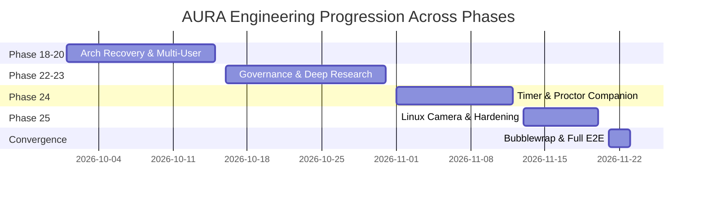

# AURA ENGINEERING JOURNAL & CHRONOLOGICAL DEVELOPMENT LOG
## Reconstructed Milestone History, Forensic Debugging, and Systems Evolution

**Course:** `26ECAC401` — Agentic AI, Semester VII, AY 2026–27  
**Institution:** KLE Technological University, Hubballi  
**System:** AURA (Online Course Examination System)  
**Lead Engineer:** Vikas Umesh Badiger (USN: `01FE23BCI094`)  
**Data Sources:** Git Commit Log, Master Acceptance Ledgers, Test Suite Transcripts  

---

## 1. ENGINEERING OBJECTIVE & PHILOSOPHY

This journal documents the technical evolution of AURA from initial architectural recovery to the final converged multi-agent examination system. Entries are chronologically reconstructed from verified Git commit timestamps, automated test transcripts, and forensic debugging records.

---

## 2. CHRONOLOGICAL MILESTONE ENTRIES

### Milestone 1: Architectural Recovery & UI Foundation (Phases 18–19)
- **Git Commits:** `82feaa4` (Phase 18), `f2e893b` (Phase 19)
- **Objective:** Recover broken frontend layouts, restore Tailwind CSS compilation, and establish holdout RAG benchmark fixtures.
- **Problem Identified:** Next.js route handlers failed to resolve relative package symlinks; UI suffered from styling breakage and unhandled hydration errors.
- **Implementation:** Restored monorepo package symlinks; repaired Tailwind utility classes; validated basic browser rendering across desktop viewports.
- **Observed Result:** Clean frontend compilation across all primary views.

### Milestone 2: Multi-User Architecture & Role Governance (Phase 20)
- **Git Commits:** `b320d7c`, `0a0a6f9`, `943bdae`
- **Objective:** Establish isolated role personas (COE, Faculty, Candidate, Invigilator) with deterministic OPA policy gating.
- **Problem Identified:** Multi-student attempt sessions suffered from cross-talk in session storage; correct answer keys were inadvertently exposed in client-facing question payloads.
- **Debugging & Resolution:** Decoupled correct answers from student paper snapshots (`exam_paper_snapshots`); isolated answer keys exclusively in `exam_paper_answer_keys`; enforced OPA Rego evaluation for candidate registration.
- **Verification:** 23/23 demo gates verified clean on staging environment.

### Milestone 3: Institutional Lifecycle Governance & Data Modeling (Phases 22–23)
- **Git Commits:** `f592111`, `265daa4`, `89565a7`, `c76994d`
- **Objective:** Complete institutional academic hierarchy (departments, programs, courses, syllabus versions, blueprints) and integrate deep research RAG workflows.
- **Implementation:** Structured 21 sequential PostgreSQL migrations; integrated pgvector HNSW indexing; linked grievance submission and resolution directly to database endpoints.
- **Observed Result:** Complete academic data flow established from syllabus upload to question bank approval.

### Milestone 4: Scheduled Examination & Edge Proctoring (Phase 24)
- **Git Commits:** `32adf66`, `9584b94`, `3abefbd`, `7b360fd` (Tag: `aura-v24.3-stable`)
- **Objective:** Deploy authoritative server-side exam countdown timers and engineer the edge desktop proctor companion.
- **Problem Identified:** Client-side JavaScript timers were susceptible to local clock tampering; companion pairing encountered a deadlock during initial WebSocket handshake.
- **Debugging & Resolution:** Relocated timer authority exclusively to PostgreSQL server timestamps; redesigned companion pairing protocol with cryptographic PIN exchange; tagged stable baseline `aura-v24.3-stable`.
- **Verification:** Verified monotonic autosave and non-punitive incident streaming.

### Milestone 5: Linux Camera Recovery & Real-Time Behavior Verification (Phase 25)
- **Git Commits:** `85c2a57`, `7066066`, `70684b9`
- **Objective:** Recover real physical Ubuntu camera feed and implement real-time 3D head pose and eye-gaze tracking.
- **Problem Identified:** Electron desktop companion displayed a black preview on Linux due to V4L2 device permission issues and unhandled mirrored orientation.
- **Implementation:** Repaired MediaPipe 468-point face mesh pipeline; integrated 6-point solvePnP head-pose estimation (yaw, pitch, roll); configured calibrated thresholds for left/right head turn and eye gaze deviation.
- **Verification:** Successfully captured moving physical camera feed and delivered authenticated incident telemetry through Gate D.

### Milestone 6: Proctor Companion Enforcement & Security Hardening (Phase 25.5)
- **Git Commits:** `95effa4`, `476238a`, `a8ecdaa`
- **Objective:** Make proctor companion mandatory during active examinations; enforce strict auto-finalization upon companion termination.
- **Problem Identified:** Potential security vulnerabilities: cross-student shutdown forgery, race conditions on concurrent finalization calls, and orphaned sessions after ungraceful crashes.
- **Debugging & Resolution:**
  - Implemented anti-forgery verification rejecting attempt ID / student ID mismatches with HTTP 403.
  - Implemented atomic, idempotent finalization transactions preventing duplicate submissions.
  - Established a 15-second heartbeat lease: sessions lapse and auto-finalize if no heartbeat is received.
  - Engineered background Node.js reaper daemon sweeping stale sessions every 5 seconds.
  - Built audited COE recovery control (`RESUME_EXAM`) for accidental technical disconnects.
- **Verification:** 8/8 hardening test assertions passed with 100% success.

### Milestone 7: Isolated Bubblewrap Coding Judge & Final Convergence (Phase 25 Integration)
- **Git Commits:** `7bb355a`, `7eee029` (Branch: `integration/phase25-companion-coding`)
- **Objective:** Converge independent companion enforcement and coding branches into ONE unified, fully operational system.
- **Implementation:**
  - Cloned clean integration database `aura_phase25_integration` (Port 54322).
  - Built Linux Bubblewrap judge (`apps/web/src/lib/coding/bwrapJudge.ts`) with `--unshare-all`, read-only mounts, and ephemeral tmpfs scratch spaces.
  - Connected interactive code runner in candidate exam interface (Python, C++, Java).
  - Built unified launcher (`scripts/integration/start_aura_integration.sh`) and acceptance runner (`scripts/integration/generate_final_acceptance_report.sh`).
- **Verification:** All 7 verification suites passed (100% success rate); working tree committed clean.

---

## 3. SUMMARY OF SYSTEM MATURITY

