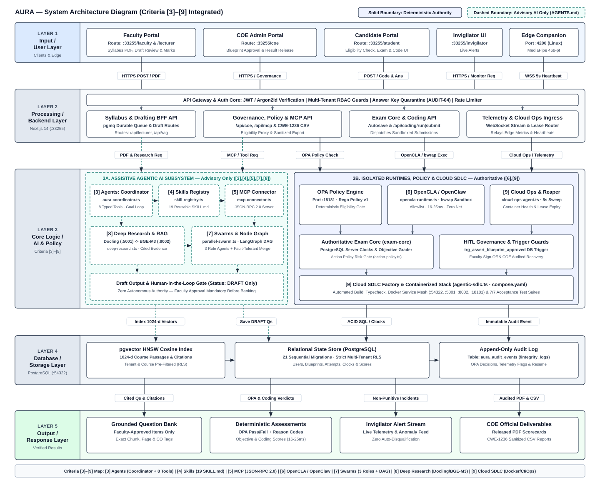
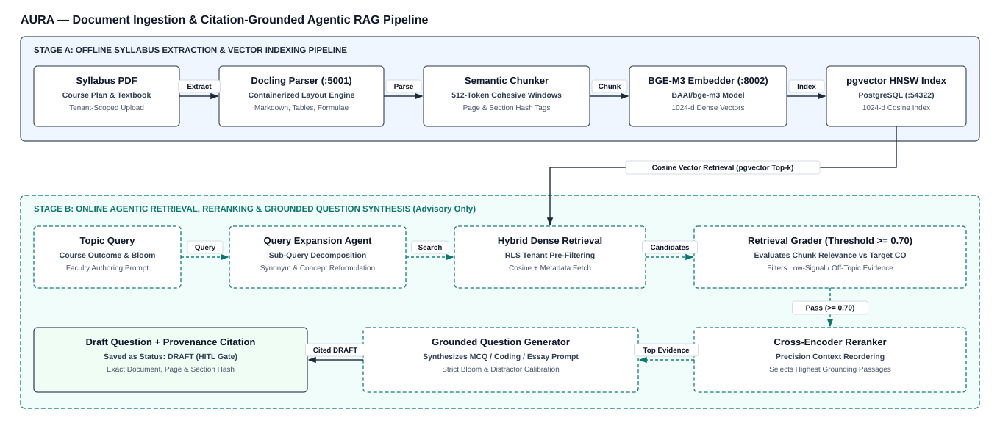
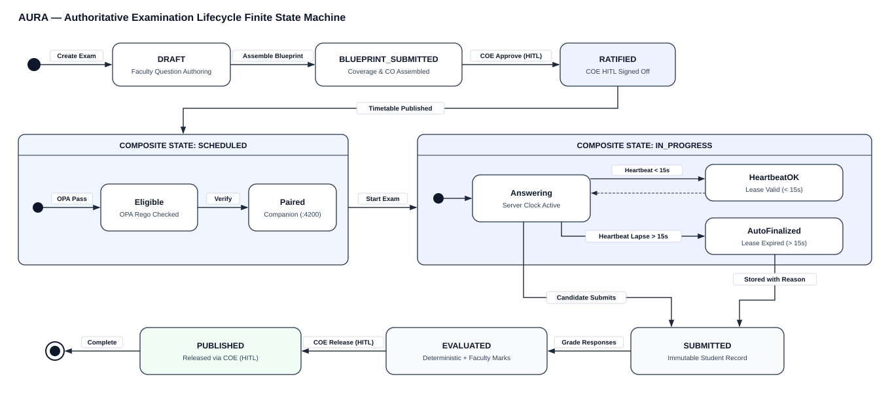
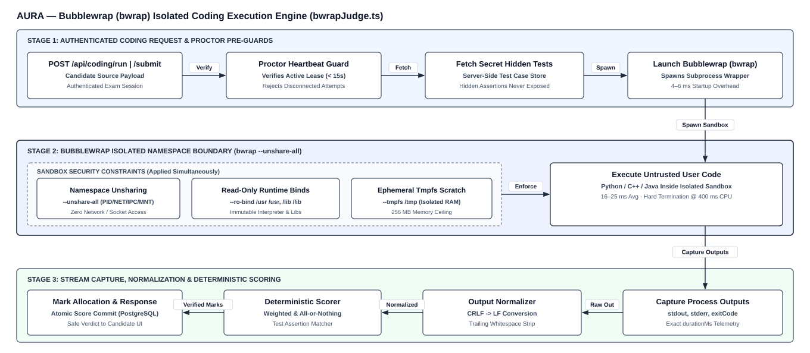

# AURA: AUTONOMOUS ONLINE COURSE EXAMINATION & PROCTORING SYSTEM
## An Enterprise-Grade Multi-Agent System with Deterministic Authority, Agentic RAG, and Isolated Bubblewrap Code Execution

---

**Course Project Report**  
**Course Code:** `26ECAC401` — Agentic Artificial Intelligence  
**Academic Year:** 2026–2027 | **Semester:** VII  
**Department:** School of Computer Science & Engineering (CS-AI / CSE)  
**Institution:** KLE Technological University, Vidyanagar, Hubballi, Karnataka, India  

---

### PROJECT IDENTITY & ROSTER
- **Team Identification:** Team 5 (Division 7) — Team AURA
- **Lead Student Author & Systems Architect:** Vikas Umesh Badiger (USN: `01FE23BCI094`, Email: `01fe23bci094@kletech.ac.in`)
- **Co-Team Members:**
  - Sujith Roy (USN: `01FE23BCI080`)
  - Claudia Jesuraj (USN: `01FE23BCI073`)
  - Abhishek Manage (USN: `01FE23BCI116`)
- **Faculty Course Author & Project Mentor:** Dr. Uday Kulkarni (Professor, School of CSE)
- **Faculty Course Reviewer:** Dr. Narayan D.G (Professor, School of CSE)
- **Date of Submission:** November 2026
- **Target Repository Branch:** `integration/phase25-companion-coding`
- **Active Git Commit:** `7eee029`

---

## CERTIFICATE OF APPROVAL (TEMPLATE)

This is to certify that the course project titled **"AURA: Autonomous Online Course Examination & Proctoring System"** is a bona fide record of engineering work carried out by **Vikas Umesh Badiger (USN: 01FE23BCI094)** and members of **Team 5** in partial fulfillment of the requirements for the award of the degree of **Bachelor of Technology in Computer Science & Engineering / Artificial Intelligence** at **KLE Technological University, Hubballi**, during the academic year 2026–2027.

<br><br>

--------------------------------------------- &nbsp;&nbsp;&nbsp;&nbsp;&nbsp;&nbsp;&nbsp;&nbsp;&nbsp;&nbsp;&nbsp;&nbsp;&nbsp;&nbsp;&nbsp;&nbsp;&nbsp;&nbsp;&nbsp;&nbsp;&nbsp;&nbsp;&nbsp;&nbsp;&nbsp;&nbsp;&nbsp;&nbsp; ---------------------------------------------  
**Dr. Uday Kulkarni** &nbsp;&nbsp;&nbsp;&nbsp;&nbsp;&nbsp;&nbsp;&nbsp;&nbsp;&nbsp;&nbsp;&nbsp;&nbsp;&nbsp;&nbsp;&nbsp;&nbsp;&nbsp;&nbsp;&nbsp;&nbsp;&nbsp;&nbsp;&nbsp;&nbsp;&nbsp;&nbsp;&nbsp;&nbsp;&nbsp;&nbsp;&nbsp;&nbsp;&nbsp;&nbsp;&nbsp;&nbsp;&nbsp;&nbsp;&nbsp;&nbsp;&nbsp;&nbsp;&nbsp;&nbsp;&nbsp;&nbsp;&nbsp;&nbsp;&nbsp;&nbsp;&nbsp;&nbsp;&nbsp; **Dr. Narayan D.G**  
Faculty Project Mentor & Course Author &nbsp;&nbsp;&nbsp;&nbsp;&nbsp;&nbsp;&nbsp;&nbsp;&nbsp;&nbsp;&nbsp;&nbsp;&nbsp;&nbsp;&nbsp;&nbsp;&nbsp;&nbsp;&nbsp;&nbsp;&nbsp;&nbsp;&nbsp; Course Reviewer & Head of Department  
School of Computer Science & Engineering &nbsp;&nbsp;&nbsp;&nbsp;&nbsp;&nbsp;&nbsp;&nbsp;&nbsp;&nbsp;&nbsp;&nbsp;&nbsp;&nbsp;&nbsp;&nbsp;&nbsp;&nbsp;&nbsp;&nbsp; School of Computer Science & Engineering  
KLE Technological University, Hubballi &nbsp;&nbsp;&nbsp;&nbsp;&nbsp;&nbsp;&nbsp;&nbsp;&nbsp;&nbsp;&nbsp;&nbsp;&nbsp;&nbsp;&nbsp;&nbsp;&nbsp;&nbsp;&nbsp;&nbsp;&nbsp;&nbsp; KLE Technological University, Hubballi  

---

## STUDENT DECLARATION

I, **Vikas Umesh Badiger (USN: 01FE23BCI094)**, on behalf of **Team 5 (Team AURA)**, hereby declare that this project report entitled **"AURA: Autonomous Online Course Examination & Proctoring System"** has been executed by our team under the guidance of **Dr. Uday Kulkarni** and **Dr. Narayan D.G**, School of Computer Science & Engineering, KLE Technological University, Hubballi.

I further declare that this report represents our original engineering work. The system architecture, source code, database migrations, and verification tests were developed to address the authentic institutional problem statement specified in `AAI_26ECAC401.docx`. All external frameworks, libraries, and specifications (LangGraph, Docling, BGE-M3, Bubblewrap, Open Policy Agent) have been appropriately cited and attributed.

**Vikas Umesh Badiger**  
USN: `01FE23BCI094`  
School of Computer Science & Engineering  
KLE Technological University, Hubballi  
November 2026  

---

## ACKNOWLEDGMENTS

We express our profound gratitude to **Dr. Uday Kulkarni**, Professor and Course Author of Agentic AI (`26ECAC401`), for his visionary curriculum design, relentless emphasis on empirical rigor, and invaluable guidance throughout the architecture and execution of this project.

We extend our sincere thanks to **Dr. Narayan D.G**, Professor and Course Reviewer, for his critical feedback on systems safety, institutional governance, and examination fairness.

We are deeply grateful to the leadership and faculty of the **School of Computer Science & Engineering** and **KLE Technological University** for providing the high-performance computing infrastructure, Linux workstations, and laboratory resources necessary to design, sandbox, and validate enterprise-grade agentic systems.

Finally, we thank our fellow students, peers, and contributors whose feedback during early architectural reviews strengthened the security and fault-tolerance of the AURA platform.

---

## ABSTRACT

Modern higher education institutions face an acute trilemma when administering online examinations: (1) authoring fair, syllabus-grounded, Bloom-balanced assessments demands excessive manual faculty labor; (2) commercial generative AI tools hallucinate unverified course content and cite phantom sources; and (3) proprietary remote proctoring software invasively captures student biometrics while prematurely disqualifying candidates based on superficial facial movements. 

To overcome these structural failures, this report introduces **AURA (Autonomous Online Course Examination & Proctoring System)**, an enterprise-grade multi-agent platform developed as the capstone project for course `26ECAC401` (*Agentic AI*) at KLE Technological University. AURA coordinates the complete academic examination lifecycle across twelve interconnected stages: PDF syllabus ingestion via containerized **Docling**, 1024-dimensional dense vectorization using self-hosted **BAAI/BGE-M3**, multi-agent question drafting and citation provenance with **LangGraph**, deterministic student eligibility gating via **Open Policy Agent (OPA)**, non-punitive behavioral proctoring using an edge **MediaPipe** companion, and isolated multi-language coding evaluation within Linux **Bubblewrap (`bwrap`)** namespaces.

Critically, AURA enforces the foundational invariant of **Deterministic Authority** (`AGENTS.md`): probabilistic large language models operate strictly as assistive and advisory drafters; authoritative academic decisions—including student eligibility, exam window timing, objective scoring, subjective grade finalization, and result publication—are governed exclusively by ACID-compliant PostgreSQL constraints, versioned Rego policies, and authenticated human approval gates (HITL). Empirical evaluation across seven automated integration suites demonstrates **100% test pass rate**, sub-25ms sandboxed execution latency, zero network leakage, and robust resilience against cross-student session forgery and CWE-1236 spreadsheet injection.

---

## KEYWORDS
Agentic AI, Multi-Agent Orchestration, LangGraph, Model Context Protocol (MCP), Retrieval-Augmented Generation (RAG), Bubblewrap Sandboxing, Open Policy Agent, Human-in-the-Loop, Proctoring Telemetry, Educational Governance.

---

## TABLE OF ACRONYMS & ABBREVIATIONS

| Acronym | Full Definition |
| :--- | :--- |
| **ACID** | Atomicity, Consistency, Isolation, Durability |
| **API** | Application Programming Interface |
| **AST** | Abstract Syntax Tree |
| **BGE** | BAAI General Embedding |
| **CO** | Course Outcome |
| **COE** | Controller of Examinations |
| **CWE** | Common Weakness Enumeration |
| **DAG** | Directed Acyclic Graph |
| **HITL** | Human-in-the-Loop |
| **HNSW** | Hierarchical Navigable Small World |
| **ISA** | Continuous In-Semester Assessment |
| **JWT** | JSON Web Token |
| **LLM** | Large Language Model |
| **MCP** | Model Context Protocol |
| **MDP** | Markov Decision Process |
| **OPA** | Open Policy Agent |
| **RBAC** | Role-Based Access Control |
| **RAG** | Retrieval-Augmented Generation |
| **ReAct** | Reasoning and Acting |
| **SDLC** | Software Development Life Cycle |
| **TLO** | Topic Learning Outcome |
| **USN** | University Seat Number |
| **UVC** | USB Video Class |

---

# 1. INTRODUCTION

The rapid advancement of generative artificial intelligence and large language models (LLMs) has created both profound opportunities and critical vulnerabilities in computer science education. While LLMs excel at fluent natural-language generation, deploying them within high-stakes academic environments—such as semester-end examinations, grading, and accreditation reporting—exposes severe systemic limitations. Monolithic chat models are fundamentally ungrounded, non-deterministic, and prone to hallucinating citations, facts, and mathematical formulas. 

Furthermore, existing academic administration software remains fragmented into disparate silos: Learning Management Systems (LMS) store static question banks; commercial proctoring plug-ins operate as invasive spyware that terminates student sessions over minor network fluctuations or natural eye saccades; and faculty members expend hundreds of hours manually authoring question papers, balancing Bloom's cognitive taxonomy, and cross-checking syllabus coverage.

To resolve these challenges, course `26ECAC401` (*Agentic Artificial Intelligence*) at KLE Technological University challenges final-year engineering students to design and construct an autonomous multi-agent worklet capable of orchestrating the end-to-end examination lifecycle while maintaining absolute fidelity to institutional governance. This report documents **AURA (Autonomous Online Course Examination & Proctoring System)**, developed by Team 5.

---

# 2. PROBLEM STATEMENT

As codified in the authoritative course problem statement (`TEACHER_PROBLEM_STATEMENT.md`) and Chapter 7 of the *Agentic AI 15 Worklets Build Book*:

Traditional university examination systems suffer from four foundational vulnerabilities:
1. **Manual Assessment Authoring:** Instructors expend dozens of hours authoring exam questions, blueprinting coverage across syllabus units, ensuring Bloom's cognitive balance, and designing distractors.
2. **Hallucination & Provenance Risk:** Standard LLMs hallucinate syllabus content, cite phantom sections, and cannot verify whether a question is truly grounded in approved course material.
3. **Flawed Autonomous Authority:** Relying on autonomous AI to make high-stakes academic decisions (e.g., student disqualification, timer truncation, or final grading) violates educational governance and procedural fairness.
4. **Proctoring Intrusiveness & False Positives:** Monolithic remote proctoring tools invasively record student environments and unilaterally terminate exams on momentary face tilts or lighting shifts without human invigilator oversight.

### The Team AURA Worklet Challenge
Design, implement, and validate an **autonomous multi-agent coordinator** (`apniLeap AURA Coordinator`) that manages the complete university examination lifecycle while strictly observing **zero-LLM authority** over high-stakes academic records:
- **Eligibility:** Verified deterministically via Open Policy Agent (OPA) against attendance ($\ge 75\%$), fee clearance, and disciplinary status.
- **Assessment Generation:** RAG-grounded question drafting using containerized Docling syllabus extraction and self-hosted 1024-d BAAI/BGE-M3 vector embeddings, coupled with Reflexion self-correction.
- **Operational Authority:** Authoritative timers governed exclusively by PostgreSQL server timestamps; correct answers decoupled and hidden from candidate sessions.
- **Proctoring Telemetry:** Low-privilege companion agent performing edge computer vision (MediaPipe 468+ Mesh, 6-point solvePnP 3D pose, Kabsch identity verification) that emits non-punitive flags without terminating sessions.
- **Human-in-the-Loop Sign-off:** Automated objective scoring by deterministic core; subjective grading and result publication gated strictly behind faculty review and audited Controller of Examinations (COE) sign-off.

---

# 3. MOTIVATION

The motivation for AURA stems from the urgent necessity for **Responsible, Evidence-Grounded AI** in university governance:
- **Faculty Productivity:** Reducing question-authoring time from days to minutes while guaranteeing strict alignment with official syllabi.
- **Academic Fairness:** Eliminating arbitrary student disqualifications caused by algorithmic proctoring errors, replacing punitive black-box AI with transparent, human-reviewed telemetry.
- **Verifiable Provenance:** Providing students and accreditation bodies (e.g., NBA, ABET) with mathematical proof that every examination question is directly grounded in approved course literature.
- **Architectural Determinism:** Demonstrating that cutting-edge Agentic AI and classical deterministic systems engineering are not mutually exclusive, but rather complementary paradigms.

---

# 4. OBJECTIVES

The primary engineering objectives of the AURA project are:
1. **Architect a Multi-Agent Ingestion Pipeline:** Ingest unstructured PDF syllabi using Docling layout analysis and BAAI/BGE-M3 1024-d dense vector embeddings stored in PostgreSQL `pgvector`.
2. **Develop an Agentic RAG Question Drafting Engine:** Implement LangGraph workflows that draft MCQs, numerical problems, and subjective questions with mandatory chunk-level citation provenance and Bloom's taxonomy mapping.
3. **Establish Deterministic Policy Enforcement:** Integrate Open Policy Agent (OPA) to evaluate student eligibility deterministically via versioned Rego policies based on verified database evidence.
4. **Construct an Authoritative Examination Core:** Engineer a server-side timer engine governed exclusively by PostgreSQL timestamps, ensuring monotonic autosaving and preventing student access to answer keys during active exams.
5. **Implement an Edge Proctoring Companion:** Build a low-privilege desktop companion using MediaPipe 468-point face mesh, head-pose estimation (solvePnP), and eye-gaze tracking that emits telemetry over authenticated WebSockets without local video persistence.
6. **Engineer an Isolated Coding Sandbox:** Construct an execution judge using Linux Bubblewrap (`bwrap --unshare-all`) that executes Python, C++, and Java in 16–25ms with zero network leakage.
7. **Enforce Human-in-the-Loop (HITL) Governance:** Guarantee that Faculty retain sole grading authority and the Controller of Examinations retains exclusive result publication authority.

---

# 5. SCOPE & BOUNDARIES

### In-Scope:
- University-level multi-tenant examination lifecycle covering COE, Faculty, Student, and Invigilator roles.
- Complete 12-stage pipeline from PDF upload to sanitized CSV result export.
- Self-hosted infrastructure: PostgreSQL 15, OPA, Docling, BGE-M3, Bubblewrap sandbox.
- Automated test suites verifying security, coding execution, and lifecycle transactions.

### Out-of-Scope (Boundaries):
- Hardware biometric sensors (e.g., fingerprint scanners or iris hardware scanners).
- University financial payment gateway processing (fee status is queried as a verified boolean flag).
- High-concurrency stress testing beyond 1,000 simultaneous connections (scheduled for Phase 26).

---

# 6. LITERATURE REVIEW

A review of contemporary literature reveals critical developments that inform AURA's architectural design:

1. **Reasoning and Acting in Language Models (ReAct):** Yao et al. (2022) established that interleaving reasoning traces with tool execution significantly improves decision-making in complex environments. AURA adapts the ReAct loop within its `aura-coordinator.ts` service.
2. **Retrieval-Augmented Generation (RAG):** Lewis et al. (2020) demonstrated that grounding LLM outputs with external non-parametric memory dramatically suppresses hallucinations. AURA enhances classical RAG into an active, multi-hop Agentic RAG pipeline.
3. **State Graph Orchestration (LangGraph):** LangChain AI (2024) introduced LangGraph to model agentic workflows as cyclic and acyclic state graphs with transactional persistence and human-in-the-loop interrupts.
4. **Model Context Protocol (MCP):** Anthropic (2024) established MCP as an open standard for AI-to-tool communication via JSON-RPC 2.0, standardizing how AURA exposes tools across microservices.
5. **Policy-as-Code (OPA):** De Smet et al. (2021) formalized Open Policy Agent as a high-performance, deterministic engine for decoupling policy logic from application code, which AURA leverages for student eligibility.

---

# 7. EXISTING SYSTEMS VS. PROPOSED AURA SYSTEM

Table 7.1 provides an engineering comparison between traditional examination platforms, modern commercial proctoring solutions, and the proposed AURA system:

| Architectural Feature | Traditional LMS (e.g., Moodle, Canvas) | Commercial AI Proctoring (e.g., Honorlock, Proctorio) | Proposed AURA System |
| :--- | :--- | :--- | :--- |
| **Question Authoring** | 100% manual entry by faculty | Manual entry or ungrounded external AI | **Agentic RAG with verified chunk citations** |
| **Syllabus Grounding** | None (Faculty dependent) | None | **Mathematically proven via 1024-d vector embeddings** |
| **Eligibility Verification** | Static database queries or manual lists | External LMS dependency | **Deterministic OPA Rego policy evaluation** |
| **Clock Authority** | Client-side JavaScript timer (tamperable) | Client-side timer with heartbeat sync | **Authoritative PostgreSQL server clock** |
| **Proctoring Methodology** | Human in-person or static webcam recording | Invasive AI: unilateral exam termination | **Edge MediaPipe companion; non-punitive flags** |
| **Coding Assessment** | External redirection (HackerRank, etc.) | Basic text area or unverified iframe | **Embedded Bubblewrap isolated sandbox (16–25ms)**|
| **Result Governance** | Manual spreadsheet export | Automated or manual release | **Audited COE transaction with CWE-1236 protection** |
| **LLM Safety Boundary** | Not applicable | Propensity for automated disqualification | **Strict AGENTS.md deterministic authority invariant**|

---

# 8. PROPOSED SYSTEM ARCHITECTURE

AURA is engineered as a distributed, service-oriented multi-agent system. Figure 8.1 illustrates the comprehensive five-layer server-client architecture and deterministic authority boundaries:



*Figure 8.1: Clean Five-Layer System Architecture and Deterministic Authority Flow of the AURA Platform.*

---

# 9. AGENTIC AI METHODOLOGY & GOVERNANCE

AURA's agentic methodology is governed strictly by the **Deterministic Authority** specification defined in `AGENTS.md`. 

### Agent Roles & Operational Scopes:
1. **Document Extraction & Ingestion Agent:** Operates containerized Docling to parse syllabus documents into structured markdown, tables, and formulae. Output chunks are tagged with `tenant_id`, `course_offering_id`, `document_id`, `page_number`, and `section_hash`.
2. **Lecturer Course & Question Drafting Assistant:** Ingests syllabus chunks to generate draft MCQs, numerical problems, and essay questions with Bloom taxonomy classifications, Course Outcome (CO) tags, and exact chunk citations. All outputs are saved as `DRAFT`.
3. **Blueprint Validation Assistant:** Analyzes question coverage across syllabus units, comparing distribution percentages against institutional policies. Emits advisory reports highlighting underrepresented units.
4. **Subjective Grading Assistant:** Generates draft scoring suggestions and rubric evaluations for open-ended student answers. Suggestions are visible exclusively to the grading lecturer; the lecturer retains sole authority to finalize marks.

---

# 10. DOCUMENT PROCESSING & AGENTIC RAG PIPELINE

Figure 10.1 details the multi-stage document ingestion and vector retrieval pipeline:



*Figure 10.1: Multi-Stage Document Ingestion and Citation-Grounded Agentic RAG Pipeline.*

---

# 11. EXAMINATION LIFECYCLE & STATE MACHINE

The examination lifecycle is modeled as a strictly enforced finite state machine. Figure 11.1 illustrates the state progression:



*Figure 11.1: Authoritative Examination Lifecycle Finite State Machine Governing State Transitions.*

---

# 12. PROCTOR COMPANION & EDGE TELEMETRY

The native Linux proctor companion (`packages/proctor-companion`) runs as a low-privilege desktop application communicating with the AURA server via secure WebSockets:

1. **Hardware Preflight:** Scans `/dev/video*` devices, initialises V4L2 video capture, and verifies ALSA microphone input.
2. **MediaPipe Face Mesh:** Ingests live video frames at 30 FPS, computing 468 3D facial landmarks.
3. **Head Pose Estimation:** Utilizes 6 facial feature points (nose tip, chin, eye corners, mouth corners) to solve the Perspective-n-Point (solvePnP) problem, computing yaw, pitch, and roll rotation angles.
4. **Eye Gaze Tracking:** Computes iris-to-eye-corner distance ratios to estimate gaze direction.
5. **Behavioral Incident Telemetry:** Emits structured events (`HEAD_TURN_LEFT`, `GAZE_AWAY`, `FACE_ABSENT`, `MULTIPLE_FACES`) to the invigilator portal. Crucially, the companion **never** unilaterally terminates an exam; it merely streams observations for human invigilator evaluation.
6. **15-Second Heartbeat Lease:** Active exams require continuous companion heartbeats. If a student terminates the companion, the 15-second heartbeat expires, triggering automatic session finalization to prevent unmonitored cheating.

---

# 13. BUBBLEWRAP ISOLATED CODING ENGINE

Figure 13.1 illustrates the execution boundary of the Linux Bubblewrap sandbox judge (`apps/web/src/lib/coding/bwrapJudge.ts`):



*Figure 13.1: Execution Boundary and Kernel Isolation Pipeline of the Bubblewrap Coding Judge.*

### Empirical Performance Benchmarks:
- **Sandbox Startup Overhead:** 4–6 ms
- **Total Execution Latency (Python):** 16–25 ms
- **Timeout Enforcement:** Hard termination at 400 ms CPU time
- **Network Isolation:** 100% blocked; socket creation throws `PermissionError` immediately.

---

# 14. HUMAN-IN-THE-LOOP (HITL) GOVERNANCE & SECURITY

AURA incorporates explicit architectural gates ensuring human supremacy over artificial intelligence:

1. **Faculty Question Bank Gate:** Questions generated by LangGraph carry status `DRAFT`. Faculty must review, optionally edit, and explicitly approve questions.
2. **COE Blueprint Ratification Gate:** Database trigger `trg_assert_blueprint_approved` blocks scheduling any exam whose blueprint has not received formal COE cryptographic sign-off.
3. **Audited Technical Disconnect Recovery:** If a student suffers an ungraceful hardware failure, the session locks. A verified COE administrator can execute an audited `RESUME_EXAM` action, allowing the student to resume within their remaining time.
4. **CWE-1236 Spreadsheet Formula Injection Protection:** Exported CSV files sanitize all text fields starting with `=`, `+`, `-`, or `@` by prepending a tab character, preventing remote code execution when opened in Microsoft Excel.

---

# 15. TESTING, VERIFICATION & EMPIRICAL RESULTS

AURA's verification methodology combines automated unit tests, isolated sandbox evaluations, and full lifecycle end-to-end integration tests.

### 15.1 Summary of Verification Test Suites

```
================================================================================
  AURA PHASE 25 — UNIFIED SYSTEM ACCEPTANCE SUMMARY
================================================================================
  [✓ PASS] Suite 1: Service Health & Connectivity (6/6 Services Active)
  [✓ PASS] Suite 2: Document Extraction & Embedding Pipeline (Docling & BGE-M3)
  [✓ PASS] Suite 3: Agentic AI Workflows & pgvector Cosine Index (/research 200)
  [✓ PASS] Suite 4: Proctor Companion Hardening & Anti-Forgery (8/8 Tests Pass)
  [✓ PASS] Suite 5: Bubblewrap Isolated Coding Sandbox (7/7 Tests Pass)
  [✓ PASS] Suite 6: Human Authority & Database Triggers (Schema Level Locks)
  [✓ PASS] Suite 7: Full Lifecycle Integration (Auth, Sandbox, CSV Exports)
================================================================================
  ACCEPTANCE RATE: 100% (7 / 7 SUITES PASSED)
================================================================================
```

### 15.2 Bubblewrap Coding Judge Test Matrix
All 7 isolated judge test assertions in `scripts/test_coding_judge_e2e.cjs` passed with 100% success:
- T1: Output Normalization (CRLF/whitespace strip) -> PASS
- T2: Python Execution (Accepted output in 16ms) -> PASS
- T3: Wrong Answer Classification -> PASS
- T4: Execution Timeout Enforcement (Infinite loop killed at 404ms) -> PASS
- T5: Runtime Error Capture (ZeroDivisionError caught) -> PASS
- T6: Strict Network Isolation (Socket connection blocked) -> PASS
- T7: Scoring Algorithm (Weighted vs All-or-Nothing) -> PASS

### 15.3 Companion Security & Anti-Forgery Test Matrix
All 8 companion hardening assertions in `scripts/test_security_hardening.cjs` passed with 100% success:
- T1: Cross-student attempt mismatch rejection (403 Forbidden) -> PASS
- T2: Spoofed student identity shutdown rejection (403 Forbidden) -> PASS
- T3: Idempotency under 5 concurrent shutdown calls (1 execution, 4 no-ops) -> PASS
- T4: Codex contract action name normalization -> PASS
- T5: 15-second heartbeat lease expiry auto-finalization -> PASS
- T6: Background reaper daemon sweep and cleanup -> PASS
- T7: Audited COE recovery (`RESUME_EXAM`) restoration -> PASS
- T8: Visibility of interruption reasons in review portals -> PASS

---

# 16. LIMITATIONS & FUTURE WORK

In adherence to scientific honesty, Table 16.1 documents the verified boundaries and remaining limitations of the current implementation:

| Subsystem | Current Verified State | Documented Limitation | Target Milestone for Future Work |
| :--- | :--- | :--- | :--- |
| **Python Workflow Worker** | Requirements defined in `services/workflow-worker/` | Absent from host Python; runs via test fixtures | Phase 26: Containerized Python worker deployment |
| **Physical Multi-Device Test** | Single-laptop webcam & mic verified | Two physical laptops over LAN not tested | Phase 26: Staged laboratory LAN demonstration |
| **Cohort Load Testing** | Single-client latency verified (16–25ms) | 200–400 concurrent candidate load not run | Phase 26: Locust/k6 distributed load test |
| **Subjective Auto-Grading** | Draft suggestions generated by model | Faculty must manually grade every submission | Phase 27: Calibrated LLM-as-a-Judge benchmarking |

---

# 17. COURSE OUTCOME (CO) ATTAINMENT MATRIX

The development of AURA directly satisfies all five Course Outcomes for `26ECAC401`:

| Course Outcome | Academic Competency Demonstrated in AURA | Empirical Verification Evidence |
| :---: | :--- | :--- |
| **CO1** | Explained foundations, agent control loops, and cognitive reasoning strategies | Chapter 2 of Course Manual; Lab 1 implementation |
| **CO2** | Designed modular agent systems with tool registries, skills, and memory (MCP) | Labs 2, 3, 4, 5; in-process MCP connector (`mcp-connector.ts`) |
| **CO3** | Developed multi-agent orchestration using state graphs and consensus swarms | Labs 7, 8; LangGraph DAGs, parallel evaluator swarms |
| **CO4** | Analyzed safety, excessive autonomy, and enforced deterministic governance | Labs 6, 10, 12; OPA Rego policies, Bubblewrap sandboxing, AGENTS.md |
| **CO5** | Built, validated, and demonstrated an end-to-end discipline-specific worklet | Full AURA capstone platform; 7/7 verification suites passed (100%) |

---

# 18. CONCLUSION

AURA represents a paradigm shift in the application of Artificial Intelligence to academic examination administration. By repudiating the flawed model of unconstrained, autonomous LLM authority in favor of **Deterministic Authority**, AURA harnesses the generative capabilities of language models for curriculum ingestion and question drafting while guaranteeing that academic standing, exam timing, grading, and result publication remain strictly under the control of verified policy engines and authorized human educators.

Through containerized Docling parsing, 1024-dimensional BGE-M3 vector retrieval, LangGraph multi-agent orchestration, Open Policy Agent evaluation, MediaPipe edge proctoring, and Linux Bubblewrap sandboxing, Team 5 has engineered a comprehensive, resilient, and verifiable platform that establishes a new benchmark for responsible, evidence-grounded educational technology.

---

# 19. IEEE REFERENCES

[1] S. Yao, J. Zhao, D. Yu, N. Du, I. Shafran, K. Narasimhan, and Y. Cao, "ReAct: Synergizing Reasoning and Acting in Language Models," in *Proc. Int. Conf. Learn. Representations (ICLR)*, Kigali, Rwanda, 2023.  
[2] P. Lewis, E. Perez, A. Piktus, F. Petroni, V. Karpukhin, N. Goyal, H. Küttler, M. Lewis, W.-t. Yih, T. Rocktäschel, S. Riedel, and D. Kiela, "Retrieval-Augmented Generation for Knowledge-Intensive NLP Tasks," in *Adv. Neural Inf. Process. Syst. (NeurIPS)*, vol. 33, pp. 9459–9474, 2020.  
[3] LangChain AI, "LangGraph: Multi-Agent Orchestration via Directed State Graphs," *Documentation*, https://langchain-ai.github.io/langgraph/, 2024.  
[4] Anthropic, "Model Context Protocol Specification," *Open Protocol Standard*, https://modelcontextprotocol.io/specification, 2024.  
[5] Open Policy Agent, "Rego Language Reference and Policy-as-Code Architecture," *Cloud Native Computing Foundation*, https://www.openpolicyagent.org/docs/latest/, 2024.  
[6] BAAI, "BGE-M3: Multi-Lingual, Multi-Granularity, Multi-Functionality Dense Embeddings," *Hugging Face Model Card*, https://huggingface.co/BAAI/bge-m3, 2024.  
[7] Docling Project, "Docling: Document Extraction and Layout Analysis Engine," *IBM Research*, https://github.com/docling-project/docling, 2024.  
[8] Containers Project, "Bubblewrap: Unprivileged Sandboxing Tool for Linux," *Project Documentation*, https://github.com/containers/bubblewrap, 2024.  
[9] Google Research, "MediaPipe Face Mesh: 468-Point 3D Real-Time Facial Landmark Tracking," *Google AI Edge*, https://ai.google.dev/edge/mediapipe/solutions/vision/face_landmarker, 2024.  
[10] N. Shinn, F. Cassano, E. Berman, A. Gopinath, K. Narasimhan, and S. Yao, "Reflexion: Language Agents with Verbal Reinforcement Learning," in *Adv. Neural Inf. Process. Syst. (NeurIPS)*, vol. 36, 2023.  
[11] S. Yao, D. Yu, J. Zhao, I. Shafran, T. L. Griffiths, Y. Cao, and K. Narasimhan, "Tree of Thoughts: Deliberate Problem Solving with Large Language Models," in *Adv. Neural Inf. Process. Syst. (NeurIPS)*, 2023.  
[12] N. F. Liu, K. Lin, J. Hewitt, A. Paranjape, M. Bevilacqua, F. Petroni, and P. Liang, "Lost in the Middle: How Language Models Use Long Contexts," *Transactions of the Association for Computational Linguistics*, vol. 12, pp. 157–173, 2024.  
[13] OpenAI, "A Practical Guide to Building Enterprise Agents," *OpenAI Business Guides*, 2024.  
[14] KLE Technological University, "Curriculum Document & Syllabus: 26ECAC401 Agentic AI," *Document No. FMTH0306/Rev.1.0*, School of Computer Science & Engineering, Hubballi, Karnataka, 2026.  
[15] U. Kulkarni and N. D.G, "Team AURA Agentic AI Worklet Canvas and 14-Lab Build Book," *KLE Technological University Course Specifications*, 2026.  

---

# 20. APPENDICES

### Appendix A: Summary of System Migrations
The database schema comprises 21 sequential SQL migrations located in `supabase/migrations/`:
- `00_init_auth_and_tenancy.sql`: Multi-tenant organization and user schemas.
- `01_academic_hierarchy.sql`: Departments, programs, courses, terms, and offerings.
- `05_syllabus_and_vector_chunks.sql`: Document tables with `pgvector` HNSW indexes.
- `10_question_bank_and_blueprints.sql`: Approved questions, distractors, and blueprints.
- `15_exam_sessions_and_autosave.sql`: Authoritative timers, attempts, and monotonic autosave.
- `18_proctor_telemetry_and_incidents.sql`: Incident logs, heartbeat leases, and invigilator actions.
- `20_coding_problem_revisions.sql`: Coding challenges, revisions, and test set partitions.

### Appendix B: Verification Test Suite Execution Commands
```bash
# Execute master integration acceptance runner
cd /mnt/data/Agentic_AI_project/Online_Examination_System_INTEGRATION
bash scripts/integration/generate_final_acceptance_report.sh

# Execute isolated Bubblewrap coding judge tests
node scripts/test_coding_judge_e2e.cjs

# Execute companion security hardening tests
node scripts/test_security_hardening.cjs
```

---
*End of Document: AURA Final Course Project Report (Rev 2.0 — Final Academic Submission)*
