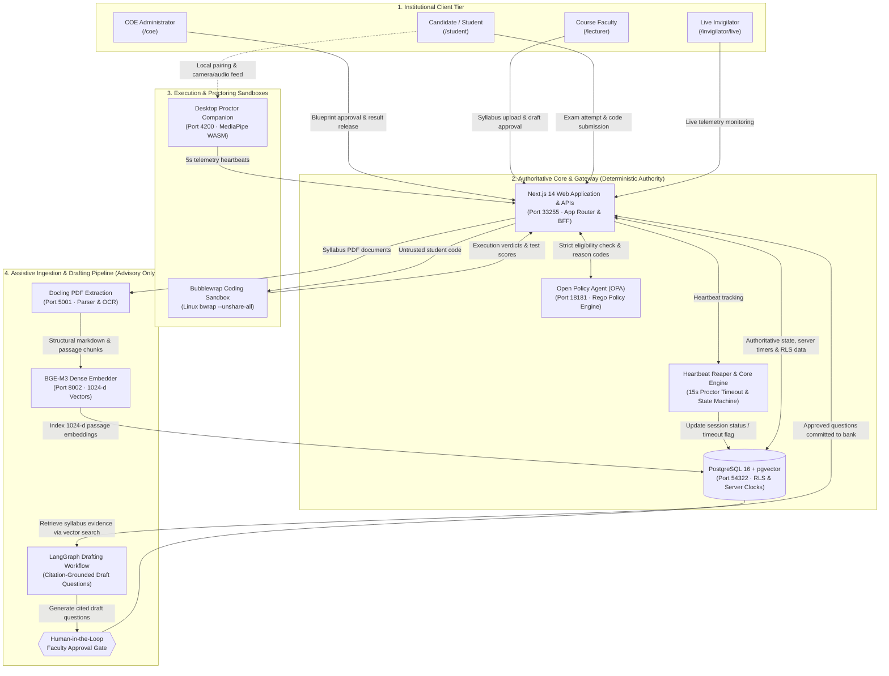

# AURA — Online Course Examination System Agent

Agentic AI (26ECAC401) · KLE Technological University · Team 5 · Division 7

| Team member | USN |
| --- | --- |
| Sujith Roy | 01FE23BCI080 |
| Claudia Jesuraj | 01FE23BCI073 |
| Abhishek Manage | 01FE23BCI116 |
| Vikas Badiger | 01FE23BCI094 |

## Course project

AURA addresses how a university can use syllabus-grounded AI assistance to prepare examinations while retaining institutional control over eligibility, grading and publication. Faculty review question drafts and the Controller of Examinations reviews blueprints and releases results.

The implementation combines a web examination runner, PostgreSQL, policy checks, document retrieval, a desktop proctor companion and an isolated coding judge. The submitted report records the judge and companion test results and identifies limitations. See sections 15 and 16 for the evidence and its scope.

- [Problem statement and academic source documents](Course-Project/Problem_Statement/)
- [Project source](Course-Project/Source_Code/)
- [Final report (PDF)](Course-Project/Final_Report/AURA_FINAL_COURSE_PROJECT_REPORT.pdf) · [Markdown](Course-Project/Final_Report/AURA_FINAL_COURSE_PROJECT_REPORT.md)
- [Course manual](Course-Project/Documentation/Course_Manual/) · [Labs 13 and 14](Assignments/Supplementary_Labs/)
- [Framework verification](Course-Project/Documentation/Framework_Verification/) · [Engineering journal](Course-Project/Documentation/Engineering_Journal/)

## Objectives

- Help faculty create syllabus-grounded questions with citations and reviewable drafts.
- Enforce exam eligibility, timing and release decisions through institutional policy and human approval.
- Support proctored assessments, coding submissions, grading and published results in a single workflow.

## Architecture and workflows

Next.js serves the role-based portals. PostgreSQL holds the exam schedule, attempts and release state, and OPA evaluates eligibility. Docling parses course PDFs, BGE-M3 supports retrieval, and LangGraph coordinates the syllabus-grounded drafting workflow. The desktop companion reports proctoring status. Bubblewrap isolates coding execution in the engineering environment.



| Role | Workflow |
| --- | --- |
| Faculty | Upload course material, verify citations, review question drafts, submit blueprints and grade responses |
| Controller of Examinations | Review blueprints, schedule exams, moderate scores and authorize result release |
| Student | Register when eligible, pair the companion, take the exam and view released scores |
| Invigilator | Review live signals and record incidents |

Faculty review governs drafts. COE approval governs scheduling and publication. The application retains deterministic authority over timing, eligibility and objective scoring.

- [System architecture](Course-Project/Architecture/ARCHITECTURE.md)
- [Demonstration guide](Course-Project/Demonstration/AURA_DEMONSTRATION_GUIDE.md)
- [Combined laboratory handbook](Course-Project/Documentation/Course_Manual/AGENTIC_AI_14_LABS.md)
- [Execution evidence](Assignments/NOTEBOOK_EXECUTION_REPORT.md)
- [References](Course-Project/Documentation/References/REFERENCES.md)
- [Repository audit](Course-Project/Documentation/Submission_Audit/FINAL_NOTEBOOK_AND_REPOSITORY_AUDIT.md)

## Assignments

[Browse all assignment files](Assignments/). Labs 01–12 are the official assignments. Labs 13–14 are supplementary.

| Lab | Topic and assignment materials | Python | Executed notebook |
| --- | --- | --- | --- |
| 01 | [Agent vs Chatbot Architecture](Assignments/Assignment_01/) | [Python](Assignments/Assignment_01/LAB_01.py) | [LAB_01](Assignments/Assignment_01/LAB_01.ipynb) |
| 02 | [Tool-Using Agent & Typed Execution Security](Assignments/Assignment_02/) | [Python](Assignments/Assignment_02/LAB_02.py) | [LAB_02](Assignments/Assignment_02/LAB_02.ipynb) |
| 03 | [Reusable Skill Contracts & Progressive Disclosure](Assignments/Assignment_03/) | [Python](Assignments/Assignment_03/LAB_03.py) | [LAB_03](Assignments/Assignment_03/LAB_03.ipynb) |
| 04 | [Memory Architecture & Long-Term Vector Retrieval](Assignments/Assignment_04/) | [Python](Assignments/Assignment_04/LAB_04.py) | [LAB_04](Assignments/Assignment_04/LAB_04.ipynb) |
| 05 | [Model Context Protocol (MCP) Standardized Connector](Assignments/Assignment_05/) | [Python](Assignments/Assignment_05/LAB_05.py) | [LAB_05](Assignments/Assignment_05/LAB_05.ipynb) |
| 06 | [OpenCLA Safe Sandboxed Runtime Execution](Assignments/Assignment_06/) | [Python](Assignments/Assignment_06/LAB_06.py) | [LAB_06](Assignments/Assignment_06/LAB_06.ipynb) |
| 07 | [Agentic Node Graph Workflow Orchestration](Assignments/Assignment_07/) | [Python](Assignments/Assignment_07/LAB_07.py) | [LAB_07](Assignments/Assignment_07/LAB_07.ipynb) |
| 08 | [Parallel Swarm Specialists & Fault-Tolerant Consensus](Assignments/Assignment_08/) | [Python](Assignments/Assignment_08/LAB_08.py) | [LAB_08](Assignments/Assignment_08/LAB_08.ipynb) |
| 09 | [Deep Research Agent with Multi-Source Evidence Tables](Assignments/Assignment_09/) | [Python](Assignments/Assignment_09/LAB_09.py) | [LAB_09](Assignments/Assignment_09/LAB_09.ipynb) |
| 10 | [Cloud Operations Agent & Approval-Gated Remediation](Assignments/Assignment_10/) | [Python](Assignments/Assignment_10/LAB_10.py) | [LAB_10](Assignments/Assignment_10/LAB_10.ipynb) |
| 11 | [Agentic SDLC Mini-Factory (Requirement to Test & Diff)](Assignments/Assignment_11/) | [Python](Assignments/Assignment_11/LAB_11.py) | [LAB_11](Assignments/Assignment_11/LAB_11.ipynb) |
| 12 | [Safety Action Policy, Risk Classification & Audit Trail](Assignments/Assignment_12/) | [Python](Assignments/Assignment_12/LAB_12.py) | [LAB_12](Assignments/Assignment_12/LAB_12.ipynb) |
| 13 | [End-to-End Capstone Studio](Assignments/Supplementary_Labs/LAB_13.md) | [Python](Assignments/Supplementary_Labs/Lab_13/LAB_13.py) | [LAB_13](Assignments/Supplementary_Labs/Lab_13/LAB_13.ipynb) |
| 14 | [Static Code Analysis and Rubric Mapping](Assignments/Supplementary_Labs/LAB_14.md) | [Python](Assignments/Supplementary_Labs/Lab_14/LAB_14.py) | [LAB_14](Assignments/Supplementary_Labs/Lab_14/LAB_14.ipynb) |

## Run the Python modules and notebooks locally

Python 3.14.4 was used for the saved runs. Create an isolated environment from the repository root:

```bash
python3 -m venv .venv
.venv/bin/python -m pip install -r Assignments/Notebook_Tooling/requirements.txt
.venv/bin/python Assignments/Assignment_01/LAB_01.py
.venv/bin/python -m ipykernel install --sys-prefix --name python3
.venv/bin/python Assignments/Notebook_Tooling/execute.py Course-Project/Documentation/Course_Manual/individual_labs
```

Lab 05 starts a local MCP stdio server. Lab 09 requires HTTPS access to docs.python.org. The recorded run executed 42 code cells and passed 43 checks across 14 notebooks. Lab 06 passed its educational and Bubblewrap checks and remains partial because the official OpenCLA runtime was unavailable.

The AURA application source uses npm workspaces. In `Course-Project/Source_Code`, install with `npm ci` and use `npm run typecheck` for workspace checks. Full demonstration requires configured local services and disposable accounts. Follow the demonstration guide and set private configuration outside version control. Full application acceptance was outside the notebook run.
